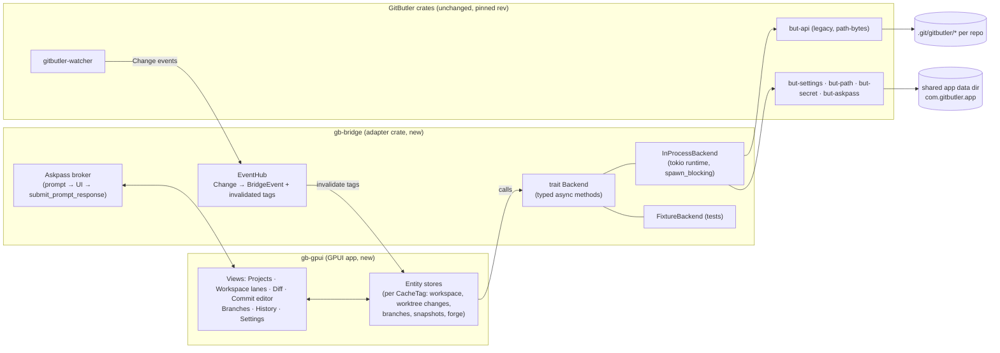

# GitButler GPUI client — analysis and implementation plan

Status: M4 window lists branches, restores snapshots, and edits or resolves commits through gb-bridge. Written 2026-10-23 (Asia/Saigon).
Upstream analysed: `gitbutlerapp/gitbutler` @ `f639899` (2026-10-22 18:30 +02:00,
"Merge pull request #16446"), shallow clone at `~/Github/gitbutlerapp/gitbutler`.

> **Moved 2026-10-26.** The app now lives in `ngosangns/gitbutler` at `apps/gb-gpui` (commit `0edbd946b1`). Paths below that say `apps/gitbutler` mean that directory. `ns-gpui` no longer builds or installs it.

## 0. Decisions (2026-10-23, from the user)

| # | Question | Decision |
|---|---|---|
| 1 | Data | **Share** data with the installed GitButler app: same app data dir (`~/Library/Application Support/com.gitbutler.app`), settings (`~/Library/Application Support/gitbutler/settings.json`), project list and keychain namespace (`com.gitbutler.app`). Built with `CHANNEL=release` (cargo `[env]` in `apps/gitbutler/.cargo/config.toml`). |
| 2 | Location | `gitbutler fork: apps/gb-gpui` (own Cargo workspace). |
| 3 | Name | `gb-gpui` (crate, binary and app); dev build installs as `gb-gpui Dev.app`. |
| 4 | Upstream pin | GitButler **release tags** (`release/X.Y.Z`), always the tag that matches the installed app. |
| 5 | MVP | M0–M3. Forge/PR (M5) later. |
| 6 | AI commit messages | Later. |
| 7 | License | Private; `apps/gb-gpui` in `~/Github/gitbutlerapp/gitbutler` (fork `ngosangns/gitbutler`) carries `LICENSE` (FSL-1.1-MIT text) + `NOTICE` keeping upstream copyright notices. ns-gpui root license unaffected. |
| 8 | Clone | Full clone with tags (done: `git fetch --unshallow --tags`). |

### Shared-data safety rules (apply to every milestone)

- **Same version as the installed app.** The pinned tag must equal the version
  of `/Applications/GitButler*.app` (`CFBundleShortVersionString` in
  `Contents/Info.plist`). On 2026-10-23 the installed app is **0.22.3**
  (`com.gitbutler.app`) → pin `release/0.22.3` (`0ba35dc`, 2026-08-29).
- **Never run migrations newer than the installed app.** gb-gpui reads the
  installed version at startup. If it differs from the pinned tag, it shows a
  banner ("GitButler X is installed, gb-gpui is built for Y") and stays in
  list-only mode (no project is opened, no database is touched).
- Before opening a project, a pre-flight check opens the project DB
  read-only (`DbHandle::open_existing_read_only_in_directory`) and verifies
  that no migration from `but_db::migration::ours()` is pending. A missing DB,
  `projects.json` or `settings.json` also means "open it in GitButler first";
  gb-gpui never creates them.
- M0 is read-only: listing uses `gitbutler_project::dangerously_list_projects_without_migration()`
  (the in-memory `migrated()` only), not `list_projects` (which may rename a
  broken `projects.json`). The full `gitbutler-watcher` is **not** used in M0
  because its handler writes hunk assignments to the project DB; M0 uses the
  read-only `gitbutler-filemonitor` to trigger re-reads. Switching to the full
  watcher is an M1/M2 decision (it does what the installed app does).
- Tests always use temp data dirs (`E2E_TEST_APP_DATA_DIR`) and fixture repos,
  never the real shared data, never real forge/OAuth.
- Updating the pin: update the installed GitButler first, then bump the tag
  to match (see `apps/gb-gpui/UPSTREAM.md`).

### M1 decision: full GitButler watcher (2026-10-23, user t403u)

From M1, gb-gpui uses GitButler's **full watcher** (`gitbutler_watcher::watch_in_background`), not
the read-only file monitor. This is what the installed app does: its handler recomputes worktree diffs
and **writes hunk assignments to the project database** (`but.sqlite`). Rules that apply from now on:

- Writes to real GitButler data happen **only** through GitButler's own watcher and API paths. gb-gpui has no
  custom SQL writes and no custom file writes under `com.gitbutler.app`, `gitbutler/` or `.git/gitbutler`.
- The version-pin guard and the `CHANNEL=release` guard stay. The pre-flight (no pending migration) runs before the
  watcher or any `Context` is opened.
- Never run gb-gpui against real data while `GitButler.app` is running (two writers on one DB).
- M1 shows hunk assignments (written by the watcher) read-only in the UI. Changing an assignment is M2.
- Tests use temp data dirs (`E2E_TEST_APP_DATA_DIR`) and fixture repos only; never real projects, never forge/OAuth.
- Live checks against real data: open and view only. Hash-compare only files that must not change
  (`projects.json`, `settings.json`). Expected watcher-written changes: `.git/gitbutler/but.sqlite` (+ `-wal`/`-shm`)
  hunk-assignment rows, and the project's lock file while open.

## 1. Summary

- **Goal:** a new native Rust/GPUI desktop UI for GitButler. GitButler's logic
  stays untouched; only the presentation layer is new.
- **Finding:** GitButler is already built for this. Every backend command is a
  plain Rust function in the `but-api` crate, annotated with `#[but_api]`. The
  macro generates the Tauri command, a JSON variant for `but-server`, and an
  optional Node (napi) variant from one source. The Svelte app, the Electron
  "lite" app, and the `but` CLI are all just clients of `but-api`. Events come
  from the `gitbutler-watcher` crate as a Rust enum.
- **Recommendation: option A, in-process.** A new GPUI app links `but-api` and
  `gitbutler-watcher` directly, exactly like `gitbutler-tauri` does, through a
  thin adapter crate (`gb-bridge`). **Zero changes to GitButler code.**
- **Verified:** a throwaway crate (`/tmp/gb-gpui-spike` on the Mac) that depends
  on `gpui-pre =0.3.8` + `but-api` (`legacy`, `path-bytes`) + `but-ctx` +
  `but-settings` + `gitbutler-watcher` resolves (1,071 packages) and passes
  `cargo check` (697 crates, 3 m 51 s cold on `-j 4`, toolchain 1.98 = GitButler's
  pinned toolchain). No dependency conflicts between GPUI and GitButler.
- **Where:** a separate Cargo workspace inside ns-gpui:
  `gitbutler fork: apps/gb-gpui/` with `crates/gb-bridge` and `crates/gb-gpui`,
  so the four existing apps do not pay GitButler's 700-crate build.
- **MVP** (M0–M3, ~11.5 Grok-CLI days): project picker, workspace lanes,
  uncommitted changes with hunk-level assignment, diff viewer, commit/amend/
  reword/squash/uncommit/move, branch management, undo, fetch/integrate
  upstream/push. Full parity incl. history, edit mode, forge/PR and settings
  is ~20 days.

## 2. Upstream layout (relevant parts)

| Path | Role |
|---|---|
| `apps/desktop` | SvelteKit + Tauri UI (the app we replace). Talks only through `src/lib/backend/` (`IBackend`: `invoke`, `listen`, + ~20 shell helpers). Two transports: `tauri.ts` and `web.ts` (HTTP + WS to `but-server`). |
| `apps/lite` | Electron + React client that loads the Rust SDK in-process via napi (`crates/but-napi`). Proof that a second UI on the same API is an intended use. |
| `apps/web` | Hosted web app (forge/cloud), not relevant. |
| `crates/but-api` | **The API layer.** ~262 `#[but_api]` functions in modules `workspace`, `branch`, `commit/*`, `diff`, `worktrees`, `land`, `resolve`, `comments`, `github`/`gitlab`/`bitbucket`, `ai`, `open`, `platform`, `tags`, `watcher`, and `legacy::{projects, virtual_branches, workspace, oplog, forge, repo, modes, users, git, remotes, secret, config, absorb, ...}`. Feature `legacy` is required for most of the desktop command set. |
| `crates/but-api-macros` | `#[but_api]`: generates `fn_json` (typed JSON params, used by Tauri), `fn_cmd` (`serde_json::Value` in/out, used by but-server), optional `fn_napi`. Also `provides = [CacheTag..]` / `invalidates = [..]` metadata. |
| `crates/gitbutler-tauri` | The desktop shell: `generate_handler!` with ~175 commands, window/watcher state (`window.rs`), menu, askpass bridge, settings watcher, updater. |
| `crates/but-server` | axum server (default `127.0.0.1:6978`): `POST /<command>` + `GET /ws` events. Used for web mode / Playwright e2e. |
| `crates/but` | The `but` CLI (`--json` / `BUT_OUTPUT_FORMAT=json`), also an MCP server and agent skill. |
| `crates/gitbutler-watcher`, `gitbutler-filemonitor` | File watcher producing `Change` events per project. |
| `crates/but-path` | App dirs. Identifier depends on compile-time `CHANNEL`/`IDENTIFIER`: default build = `com.gitbutler.app.dev`; release = `com.gitbutler.app`. `E2E_TEST_APP_DATA_DIR` redirects all app dirs (test isolation). |
| `crates/but-secret` | Keychain storage, namespaced by `set_application_namespace(identifier)`. |
| `crates/gitbutler-git` | Push/fetch through the system git with an askpass helper binary `gitbutler-git-askpass` (`GITBUTLER_ASKPASS_BIN` override). |
| `crates/but-testsupport` | Fixture/sandbox helpers used by upstream tests. |
| `packages/but-sdk` | TypeScript types generated from Rust via schemars (`but-ts`); 160 desktop files import from it → **Rust types are the source of truth**. |

Per-repo state lives in the repo itself (`.git/gitbutler/…`: DB, metadata,
oplog). App-level state (project list, settings, forge accounts) lives in the
channel's app data dir. Upstream docs worth reading: `electron-migration-assessment.md`
(their own analysis of swapping the shell), `crates/WORKSPACE_MODEL.md`
(direction: stacks → graph model).

## 3. How the frontend talks to the backend

### 3.1 Commands

- Desktop calls `backend.invoke("<command>", {projectId, ...})`.
  - Tauri: `invoke` → `#[tauri::command]` generated from `fn_json`.
  - Web/e2e: `POST {base}/<command>` with JSON params → `{type:"success"|"error", subject}`.
- Rust side: `but_api::<module>::<fn>` is the real implementation. Signature
  conventions (from the macro docs):
  - `ctx: &Context / &mut Context` ↔ `projectId` (`ProjectHandleOrLegacyProjectId`).
  - `gix::ObjectId` ↔ `json::HexHash`; `&FullNameRef` ↔ `FullName`.
  - `perm: &mut RepoExclusive` / `&RepoShared` are acquired by the wrapper
    (repo-level locking is inside the API, not the UI's job).
  - `_with_perm` variants exist for callers that already hold a lock.
- Return types are serde + schemars structs from GitButler crates
  (`but_workspace::RefInfo`, `but_hunk_assignment::WorktreeChanges`,
  `but_core::TreeChange`, `gitbutler_oplog::Snapshot`, …). A Rust client can use
  them directly; no codegen needed.

### 3.2 Command inventory (Tauri `generate_handler!`, ~175 commands)

| Group | Count | Commands (abridged) |
|---|---|---|
| Projects / app shell | 10 | `list_projects add_project add_project_best_effort get_project update_project delete_project set_project_active open_project_in_window is_gerrit server_capabilities` |
| Workspace / stacks | 23 | `get_workspace head_info branch_details set_target_ref_and_init_project discard_worktree_changes stash_into_branch workspace_branch_and_ancestors_push workspace_integrate_upstream workspace_fetch_from_remotes workspace_fetch_status workspace_target_commits resolve_worktree_conflicts show_graph_svg` + legacy `create_virtual_branch delete_local_branch get_base_branch_data set_base_branch switch_back_to_workspace update_stack_order unapply_stack list_branches get_branch_listing_details fetch_from_remotes normalize_branch_name` |
| Branches | 13 | `branch_list branch_create branch_rename branch_remove branch_canned_name branch_name_segment branch_diff move_branch tear_off_branch apply get_initial_branch_integration apply_branch_integration branch_land` |
| Diffs / hunks | 8 | `changes_in_worktree tree_change_diffs tree_change_diffs_from_source commit_details commit_details_with_line_stats assign_hunk absorb absorption_plan` |
| Commits | 11 | `commit_create commit_amend commit_reword commit_squash commit_move commit_move_changes_between commit_cherry_pick commit_insert_blank commit_uncommit commit_uncommit_changes commit_uncommit_changes_from_commits` |
| Conflicts / edit mode | 10 | `operating_mode head_sha enter_edit_mode save_edit_and_return_to_workspace abort_edit_and_return_to_workspace edit_initial_index_state edit_changes_from_initial commit_conflicts resolve_commit_conflict_hunks resolve_commit_conflicts_ai` |
| Oplog / undo | 4 | `list_snapshots create_snapshot restore_snapshot snapshot_diff` |
| Forge / PRs | 18 | `forge_provider forge_info list_reviews get_review publish_review update_review merge_review review_apply list_ci_checks get_review_merge_status set_review_auto_merge set_review_draftiness pr_templates pr_template get_repo_info …` |
| Forge accounts / auth | 20 | GitHub 8 (`init_github_device_oauth check_github_auth_status store_github_pat …`), GitLab 6, Bitbucket 6 |
| GitButler user / secrets | 10 | `users::{get_user set_user delete_user login_with_token get_login_token get_user_profile update_user_profile}`, `secret_{get,set,delete}_global` |
| Repo / git / config | 23 | `get_commit_file get_workspace_file get_blob_file find_files check_signing_settings git_clone_repository pre_commit_hook_diffspecs post_commit_hook message_hook git_remote_branches git_test_push git_test_fetch git_{get,set,remove}_global_config get_gb_config set_gb_config get_author_info list_remotes add_remote …` |
| Worktrees | 3 | `worktree_new worktree_remove worktree_set_archived` |
| Settings | 8 | `get_app_settings update_{onboarding_complete,telemetry,feature_flags,fetch,reviews,ui,telemetry_distinct_id}` (shell-side, `AppSettingsWithDiskSync`) |
| Misc shell | ~14 | `open_url open_in_terminal show_in_finder workdir_path install_cli cli_path env_vars build_type get_*_archive_path submit_prompt_response …` |
| AI | 3 (napi only) | `but_api::ai` config; the desktop's AI clients (OpenAI/Anthropic/Ollama/LM Studio) are written **in TypeScript** (`apps/desktop/src/lib/ai`). |

`but-server` routes ~158 of these. Missing today: `branch_land branch_name_segment
commit_conflicts commit_details create_snapshot env_vars resolve_commit_conflict_hunks
resolve_commit_conflicts_ai resolve_worktree_conflicts update_ui open_project_in_window
get_anonymous_graph_path` and all 6 Bitbucket commands (18 total). Upstream's own
spike also found desktop calling commands that are not routed at all (route drift).

### 3.3 Events

| Event name (desktop) | Source | Payload | Invalidates (CacheTag) |
|---|---|---|---|
| `project://{id}/git/fetch` | watcher `Change::GitFetch` | `{}` | Branches, TargetCommits, FetchStatus, Reviews |
| `project://{id}/git/head` | `Change::GitHead` | `{head, operatingMode}` | OperatingMode |
| `project://{id}/git/activity` | `Change::GitActivity` | `{headSha}` | Branches, TargetCommits, Workspace, Commits, Diffs, WorktreeChanges, Worktrees, AbsorptionPlan, Comments |
| `project://{id}/workspace-activity` | `Change::WorkspaceActivity` | `{}` | same as git/activity |
| `project://{id}/worktree_changes` | `Change::WorktreeChanges` | `WorktreeChanges` (diffs + hunk assignments + dependencies, precomputed) | Diffs, WorktreeChanges, AbsorptionPlan, Comments |
| `project://{id}/linked_worktree_changes` | `Change::LinkedWorktreeChanges` | `{worktree, changes}` | Diffs, WorktreeChanges |
| `project://{id}/external-invalidation` | sentinel written by another process (e.g. `but` CLI) | `{tags}` | the listed tags |
| `settings://update` | `AppSettingsWithDiskSync::watch_in_background` | `AppSettings` | — |
| `git_prompt` | `but_askpass::init` callback | askpass prompt; answered with `submit_prompt_response` | — |
| `menu://shortcut` | Tauri native menu | shortcut id | — |

The watcher is started per opened project by the shell
(`gitbutler_watcher::watch_in_background(handler, workdir, project_id, settings, watch_mode)`),
together with `ctx.try_exclusive_access()` (exclusive vs shared if another
process — e.g. the official GitButler app — has the project open).
`but_api::watcher::WatcherEventKind::invalidates()` and the macro's
`provides/invalidates` tags give a ready-made cache-invalidation table.

## 4. Integration options

| | A. In-process (link `but-api`) | B. `but-server` sidecar (HTTP/WS) | C. `but` CLI `--json` | D. Own JSON sidecar / napi |
|---|---|---|---|---|
| GitButler code changes | **None** | None for ~158 cmds; 18 missing need routes (upstream change) or a fork | None, but CLI covers a subset, not drag-and-drop-grade ops | None for a custom sidecar (it links `but-api`, same as A) |
| Types | Real Rust structs | `serde_json::Value`; typed only if we also link the type crates (→ same compile coupling as A) | CLI-specific JSON | JSON |
| Events | Direct `Change` enum via callback | WS `/ws` (requires a localhost `Origin` header) | None (poll) | Must build |
| Latency | Function call | HTTP per call | Process spawn per call | IPC per call |
| Askpass (push/fetch credentials) | `but_askpass::init` callback → GPUI dialog | **Disabled in but-server** (`but_askpass::disable()`) | Terminal-only | Must build |
| Secrets | Our own keychain namespace | Debug builds use git-credential storage | CLI's | — |
| Process isolation | No (a panic in API = app crash; `panic_capture` hook exists) | Yes | Yes | Yes |
| Build cost | GPUI app compiles ~700 crates | Same if typed; else just spawn a binary | Just spawn `but` | Same as A |
| Upstream tracking | Pin a git rev; API churn = compile errors (good: caught early) | Pin `but-server` binary; churn shows up at runtime | CLI JSON is more stable but narrow | — |

**Decision: A**, behind a small `Backend` trait so B can be added later
without touching UI code. Reasons: zero upstream changes, full command set
(incl. the 18 not in but-server), typed data, real askpass, direct events, and
this is exactly how upstream's own shells (Tauri, napi/lite) consume the API.
B is kept as a fallback transport (e.g. if a future GPUI/GitButler dependency
conflict appears, or for crash isolation); C is only used for optional agent
tooling.

## 5. Architecture



### 5.1 Where the code lives

```
ns-gpui/
  Cargo.toml                 # pin ely-gpui-component rev (nested workspace needs no exclude)
  apps/gitbutler/            # (now apps/gb-gpui in the gitbutler fork) separate Cargo workspace (own Cargo.lock)
    Cargo.toml               # [workspace] + [patch.crates-io] gix/git2 copied from upstream
    Cargo.lock               # seeded from upstream's Cargo.lock
    UPSTREAM.md              # pinned rev + update log
    crates/gb-bridge/        # adapter: Backend trait, InProcessBackend, EventHub, askpass, fixtures
    crates/gb-gpui/           # the GPUI app (depends on ns-ui by path)
```

- Separate workspace because linking GitButler adds ~700 crates and a 4-minute
  cold check; the other four apps stay fast and their lockfile untouched.
- ns-ui is used by path. **Required tiny ns-gpui fix:** pin
  `ely-gpui-component` to a `rev` in the root `[workspace.dependencies]`
  (today it is an unpinned git dep; outside the ns-gpui lockfile it resolves to
  HEAD, which needs `gpui-pre =0.3.9` and conflicts with `=0.3.8`. Seen in the
  spike).
- GitButler dependency: `git = "https://github.com/gitbutlerapp/gitbutler", rev = "<sha>"`
  for `but-api`, `but-ctx`, `but-settings`, `but-path`, `but-secret`,
  `but-askpass`, `gitbutler-watcher`, `gitbutler-git` (+ the type crates the
  bridge names). For local work, `.cargo/config.toml` can `[patch]` that git
  URL to `~/Github/gitbutlerapp/gitbutler`. Workspace-inherited fields in
  upstream crates resolve from the upstream checkout; only `[patch.crates-io]`
  must be copied (gix and git2 revs).
- Toolchain: GitButler pins Rust 1.98 (matches the Mac's Homebrew 1.98). Add a
  `rust-toolchain.toml` to `apps/gb-gpui` in `~/Github/gitbutlerapp/gitbutler` (fork `ngosangns/gitbutler`) with the same channel.

### 5.2 gb-bridge design

- **Calls:** typed async methods mirroring the API we use (`list_projects`,
  `head_info`, `changes_in_worktree`, `tree_change_diffs`, `assign_hunk`,
  `commit_create`, …). Each builds/opens a `but_ctx::Context` from the project
  id and calls the plain `but_api` function (or its `_json` variant when a JSON
  projection type is what the UI wants). Sync functions run in
  `tokio::task::spawn_blocking`; async ones (forge, fetch, OAuth) on the
  bridge's tokio runtime. Results go back to GPUI via a oneshot channel awaited
  in `cx.spawn`. The UI thread never blocks.
- **Errors:** map `anyhow`/`but_error` into `BridgeError {code, message, hint}`
  for toasts and inline errors (reuse `but_api::json::Error` codes).
- **Concurrency:** mutations per project go through a single queue (GitButler
  locks internally too, but queuing keeps UI state coherent and makes
  per-row "busy" states trivial — same pattern as the Hearth per-op fix).
  Reads can run in parallel.
- **Events:** one watcher per open project/window, created like
  `gitbutler-tauri/src/window.rs` (`try_exclusive_access` + `watch_in_background`).
  `Change` → `BridgeEvent` + `WatcherEventKind::invalidates()` tags → stores
  re-fetch only what is stale. `WorktreeChanges` payload is applied directly
  (no re-fetch). Flush the watcher on window focus (`WatcherHandle::flush`).
- **Settings:** `AppSettingsWithDiskSync::new_with_customization(config_dir, None)`
  + `watch_in_background` → settings store.
- **Askpass:** `but_askpass::init(callback)` → modal prompt in the UI →
  `submit_prompt_response`. Bundle `gitbutler-git-askpass` next to the app
  binary (or set `GITBUTLER_ASKPASS_BIN`).
- **Identity / data:** shared with the installed GitButler app (decision 1).
  Built with `CHANNEL=release`, keychain namespace `com.gitbutler.app`. See
  "Shared-data safety rules" in §0: version pin = installed version,
  migration pre-flight, list-only mode on mismatch. Per-repo state
  (`.git/gitbutler`) is shared too; if the installed app has the same project
  open, the bridge gets shared (non-exclusive) access and the UI shows a banner.
- **Auth:** nothing auto-starts. GitHub device flow runs only when the user
  clicks "Sign in with GitHub" (`init_github_device_oauth`, then polling
  `check_github_auth_status` only while that dialog is open, with a Cancel
  button). PAT entry is the alternative. No auth calls at startup; forge reads
  are skipped when no account is configured. Tests never call any forge/OAuth
  function (enforced by `FixtureBackend` + a test that greps for them).

## 6. Screen-by-screen UI plan

Conventions from ns-gpui: ns-ui theme/tokens, every button and icon-button has
a tooltip, `CODE_FONT` (Menlo) for diffs/hashes/paths, plain-English labels,
dev control socket via `ns_ui::devtools` (`scripts/dev.sh gitbutler …`),
`task dev:install:gitbutler`.

| # | Screen | Upstream reference | Backend calls | MVP? |
|---|---|---|---|---|
| 1 | **Projects / welcome**: topbar dropdown in the GPUI client (name, path, setup hint; see UI layout). Upstream still lists projects, adds a local repo, removes one, and can open a new window | `routes/+page`, `onboarding/*`, `ProjectSwitcher` | `list_projects add_project delete_project` | ✅ |
| 2 | **Project setup**: pick target branch & push remote | `ProjectSetup`, `ProjectSetupTarget` | `get_base_branch_data set_target_ref_and_init_project git_remote_branches` | ✅ |
| 3 | **Workspace — lanes**: one column per stack, branches top-down, commit list with timeline nodes, branch header menu (rename, delete, unapply, push), drag to reorder stacks | `MultiStackView StackView BranchCard CommitListItem` | `head_info` / `get_workspace`, `update_stack_order branch_* unapply_stack` | ✅ |
| 4 | **Uncommitted changes** panel: file list/tree, per-file and per-hunk assignment to a lane (drag-and-drop + "Move to…" menu + keyboard), discard with confirm | `UnassignedView WorktreeChanges FileList*` | `changes_in_worktree` + `worktree_changes` event, `assign_hunk discard_worktree_changes` | ✅ |
| 5 | **Diff viewer**: unified diff, hunk headers, line selection, image/binary placeholders, large-diff virtualization (`uniform_list`), line-lock (dependency) warnings | `UnifiedDiffView MultiDiffView HunkContextMenu LineLocksWarning` | `tree_change_diffs commit_details` | ✅ |
| 6 | **Commit editor**: title/body, ruler, select files/hunks, commit to lane, amend; hook results | `NewCommitView CommitMessageEditor MessageEditor` | `commit_create commit_amend pre_commit_hook_diffspecs message_hook post_commit_hook` | ✅ |
| 7 | **Commit actions**: reword, squash, uncommit, move commit (drag between lanes), move changes between commits, insert blank, cherry-pick | `CommitContextMenu CommitDropIndicator` | `commit_reword commit_squash commit_uncommit* commit_move commit_move_changes_between commit_insert_blank commit_cherry_pick` | ✅ (cherry-pick later) |
| 8 | **Upstream / sync**: fetch, "N new upstream commits", integrate modal, push branch (+ askpass dialog) | `IntegrateUpstreamModal SyncButton PushButton` | `workspace_fetch_from_remotes workspace_fetch_status workspace_integrate_upstream workspace_branch_and_ancestors_push` | ✅ |
| 9 | **Undo** (toast + ⌘Z) | oplog | `list_snapshots restore_snapshot` | ✅ |
| 10 | **Branches page**: local/remote/PR list, apply to workspace, delete | `branchesPage/*` | `list_branches get_branch_listing_details apply delete_local_branch` | M4 |
| 11 | **History (oplog)**: snapshot timeline, diff per snapshot, restore | `history/*` | `list_snapshots snapshot_diff restore_snapshot create_snapshot` | M4 |
| 12 | **Edit mode & conflicts**: edit a commit, resolve conflicted commits | `routes/[projectId]/edit`, `EditCommitPanel` | `enter_edit_mode save_edit_and_return_to_workspace abort_edit_and_return_to_workspace commit_conflicts resolve_commit_conflict_hunks` | M4 |
| 13 | **Forge**: accounts, create PR (templates), PR status/CI badges, merge | `forge/*` | `forge_* list_reviews publish_review list_ci_checks merge_review` + account cmds | M5 |
| 14 | **Settings**: global (git, appearance, integrations, telemetry off by default, experimental) and project (target, signing, hooks, remove) | `settings/* projectSettings/*` | `get_app_settings update_* get_gb_config set_gb_config check_signing_settings` | M6 |
| — | Not planned: GitButler cloud login, Gerrit, AI commit messages in MVP (desktop's AI is TS-side; later via `but-llm`/`but_api::ai`), auto-updater, telemetry. |

### UI layout (t413u)

The GPUI client draws three columns. The project list is a menu in the top bar, not a column.

```
┌──────────────────────────────────────────────────────────┐
│ gb-gpui   [fixture ▾]   M1 chip          Keyboard Refresh│
├──────────────────────────────────────────────────────────┤
│ status strip (fixed height)                              │
├────────────────┬────────────────────┬────────────────────┤
│ Uncommitted    │ Changes            │ Branches           │
│ changes        │                    │                    │
│ [list|tree]    │ Uncommitted · path │ lanes and commits  │
│ files          │ diff               │────────────────────│
│                │                    │ commit or branch   │
│                │                    │ detail (50% height)│
├────────────────┴────────────────────┴────────────────────┤
│ status bar                                               │
└──────────────────────────────────────────────────────────┘
```

The project menu lists each project's name and path (Menlo), a check on the open project, and a hint when that project needs setup or has to be opened in GitButler first. The menu is an overlay. It does not push the columns. A version mismatch still refuses to open a project and keeps the banner in the fixed-height status strip.

Uncommitted changes is a flat list grouped by lane, or a directory tree. Folders collapse, show a file count, and keep the per-file assignment chip and the +/− counts. The list/tree choice stays in the window store.

Changes shows the diff of the file focused in Uncommitted changes, or of a file inside a focused commit. The column header names the source (`Uncommitted · lane · path`, or `Commit abc1234 · branch · path`). With nothing open it says to pick a file on the left or in a commit on the right.

Branches lists stacks, branches, and commits. Focusing a branch or a commit splits this column: the list keeps the top half and scrolls, and the bottom half is the detail. A commit shows the message, author, committer, dates (absolute and relative), parents, the full SHA with a copy button, and the changed files with +/− totals. A file click opens that diff in Changes. A branch shows its name, tip, stack, commit count, pushed state when the commits say so, authors, the date range, and its commits. Ahead/behind counts are not on the bridge, so they are omitted. Esc or the close button clears the focus and the column returns to one piece.

Keyboard, in pane order Uncommitted changes → Changes → Branches, and the detail pane while it is open:

| Key | Action |
|---|---|
| ↑ ↓ | Move in the focused list |
| ← → or Tab | Move between the three columns (and into the detail pane while it is open) |
| Enter | Open the file, focus the branch or commit, or open a file from the detail |
| Esc | Close the detail, then the diff, the project menu, or the help card |
| j k | Next and previous hunk, while Changes is showing a diff |
| t | Switch list and tree |
| ⌘P | Open or close the project menu |
| ⌘R | Refresh |

The dev socket `state` reports `columns` (3), `view`, `project_menu`, `focused`, and `detail_pane`. It also accepts `project-menu action=open|close`, `view mode=list|tree`, and `focus branch=<name>|commit=<sha|index>`.

## 7. Milestones

Estimates are Grok-CLI working days (I coordinate and verify).

| Milestone | Scope | Acceptance criteria | Est. |
|---|---|---|---|
| **M0 Skeleton** | `apps/gb-gpui` in `~/Github/gitbutlerapp/gitbutler` (fork `ngosangns/gitbutler`) workspace, pinned upstream rev + lock seeded from upstream, ns-gpui ely rev pin, `gb-bridge` with `list_projects/add_project/head_info/changes_in_worktree`, EventHub, `FixtureBackend`, empty GPUI window with ns-ui chrome, `task dev:install:gitbutler`, devtools socket | `cargo test -p gb-bridge` creates a temp repo under a temp `E2E_TEST_APP_DATA_DIR`, adds it, reads `head_info`, edits a file and receives a `WorktreeChanges` event; app opens and lists projects; nothing written to `com.gitbutler.app*` | 1.5 |
| **M1 Read-only workspace** | Screens 1–3, 4 (read), 5 | Fixture repo with 2 stacks renders lanes/commits/changes; file edits appear < 1 s via watcher; diffs in Menlo; screenshots via dev socket | 3 |
| **M2 Core mutations** | Screens 4 (assign/discard), 6, 7, 9 | Commit selected hunks into a chosen lane, amend/reword/squash/uncommit/move with fixture assertions on resulting git graph; undo restores; every action has a tooltip and busy state per row | 4 |
| **M3 Remote ops** (MVP done) | Screen 2, 8, askpass dialog | Fetch/integrate/push against a local bare remote fixture (no network); askpass prompt round-trip tested with a fake prompt | 3 |
| **M4 Branches, history, edit mode** | Screens 10–12 | Fixture tests for apply/unapply, snapshot restore, conflict resolution flow | 3 |
| **M5 Forge (opt-in)** | Screen 13 | Accounts only via explicit click; PR UI tested against a stubbed forge (no real GitHub); manual test with the user's account only when the user asks | 3 |
| **M6 Settings, polish, agent skill, packaging** | Screen 14, keyboard shortcuts, `.app` bundle with askpass helper, skill per agent-toolkit plan | Settings round-trip in temp data dir; bundle launches; skill documents dev-socket commands | 2.5 |
| | | **Total** | **~20** |

## 8. Testing strategy

- **Isolation first:** every test sets `E2E_TEST_APP_DATA_DIR` to a `tempfile`
  dir (all GitButler app dirs follow it) and creates fixture repos in temp dirs
  with the git CLI or `but-testsupport` sandbox helpers. Remotes are local bare
  repos. No test touches `~/Library/Application Support/com.gitbutler.app*` or
  any real repo.
- **No real auth, ever:** `FixtureBackend` + an in-process test double for
  forge accounts; a unit test fails if test code references
  `init_github_device_oauth`/`check_github_auth_status`/`store_*_pat`.
- **Bridge contract tests** (`gb-bridge`): one test per wrapped command against
  fixtures; these are the canary when bumping the upstream rev.
- **UI tests:** GPUI test context for stores/views; visual checks through the
  ns-ui dev control socket (`scripts/dev.sh gitbutler shot …`) with a fixture
  project, never stealing focus.
- **Do not stress-run** tests that shell out to git; keep watcher tests short
  with explicit flush.

## 9. Tracking upstream

1. `UPSTREAM.md` records the pinned rev and date.
2. Update: `git -C ~/Github/gitbutlerapp/gitbutler fetch` → pick rev → bump
   `rev` in `apps/gitbutler/Cargo.toml` → re-seed `Cargo.lock` from upstream's
   lockfile (script: copy upstream `Cargo.lock`, then `cargo metadata` to add
   GPUI packages — validated in the spike) → copy `[patch.crates-io]` if it
   changed → `cargo check` → bridge contract tests → fix compile errors in
   `gb-bridge` only.
3. Watch upstream items that change shapes: `graph-workspace` feature (switches
   `WorkspaceState` from `RefInfo` to `DetailedGraphWorkspace`), the `legacy`
   namespace shrinking, stacks → graph model (`crates/WORKSPACE_MODEL.md`).
   The bridge isolates the UI from these.
4. Cadence: every 2–4 weeks or before a feature that needs a new API.

## 10. Risks

| Risk | Impact | Mitigation |
|---|---|---|
| API churn (`legacy` module, graph-workspace switch) | Compile breaks on bump | Pin rev; all upstream types touched only in `gb-bridge`; contract tests |
| UI-side logic lives in Svelte/TS (selection → DiffSpec building, RTK cache rules, dependency locks display, drag-drop rules, AI clients) | Must be re-implemented in Rust; behaviour drift | Port per screen, read the Svelte source as spec; use upstream `provides/invalidates` tables |
| Build size/time (~700 crates, libgit2, openssl/aws-lc, sqlite) | Slow first build (≈4 min check, longer release) | Separate workspace; shared `target` cache; incremental dev |
| Same project open in the official app | Two writers on `.git/gitbutler` | Detect non-exclusive access, show banner, optional read-only mode |
| In-process panic | Whole app crashes | Install `but_api::panic_capture` hook; catch_unwind around bridge calls; option B as fallback transport |
| Keychain prompts / token sharing | Confusing prompts | Own keychain namespace by default |
| GPUI widget gaps (rich commit-message editor, large virtualised diffs, cross-lane DnD) | UX effort | Reuse ely components + ns-ui; build a dedicated diff list; DnD always has a menu/keyboard alternative |
| License (below) | Distribution limits | Keep personal/internal; see open questions |

## 11. License (facts from `LICENSE.md`)

- GitButler is **FSL-1.1-MIT** (Functional Source License 1.1, MIT future
  license), © 2023-2024 GitButler Inc.
- Grant: use, copy, modify, create derivative works and redistribute **for any
  Permitted Purpose**, i.e. anything except a *Competing Use*: making the
  software available to others in a **commercial** product or service that
  substitutes for it or offers substantially similar functionality.
  Internal use, non-commercial education and research are explicitly permitted.
- Redistribution of copies/modifications/derivatives must include the terms (or
  a link) and keep copyright notices.
- No right to use GitButler trademarks or product names beyond identifying the
  origin.
- Each version becomes available under **MIT two years after** it is made
  available.
- Implication for this project (not legal advice): a personal, non-commercial
  client that links GitButler crates is a Permitted Purpose. The built binary
  includes FSL code, so the `apps/gb-gpui` in `~/Github/gitbutlerapp/gitbutler` (fork `ngosangns/gitbutler`) part should carry FSL notices and
  not be labelled MIT like the rest of ns-gpui, and the app should not be
  called "GitButler" if ever shared.

## 12. Backend changes required

**None.** Everything uses public functions of upstream crates at a pinned rev.
The only edits outside the new folder are in ns-gpui itself (pin the
`ely-gpui-component` rev; add `exclude` to the root workspace; Taskfile entry).

## 13. Open questions (answered — see §0)

1. **Data sharing:** stay isolated (dev channel, own keychain namespace —
   recommended while building) or later share projects/settings/forge tokens
   with the installed GitButler app (release identifier)?
2. **Location:** separate workspace `gitbutler fork: apps/gb-gpui` (recommended) or a
   separate repo?
3. **Name** (cannot use "GitButler" if shared): e.g. "Butler Lanes", "ns-butler"?
4. **Upstream pin cadence:** follow `master` every 2–4 weeks, or only release tags?
5. **MVP scope:** M0–M3 as proposed, or include forge/PRs (M5) earlier?
6. **AI commit messages:** skip, or later via `but-llm` (Rust) — desktop's AI is TS-only?
7. **Licensing posture:** keep `apps/gb-gpui` in `~/Github/gitbutlerapp/gitbutler` (fork `ngosangns/gitbutler`) private / FSL-marked inside the MIT ns-gpui repo — OK?
8. **Clone depth:** the clone is shallow (`--depth 1`); convert to a full clone for `git log`/blame when reading upstream?
